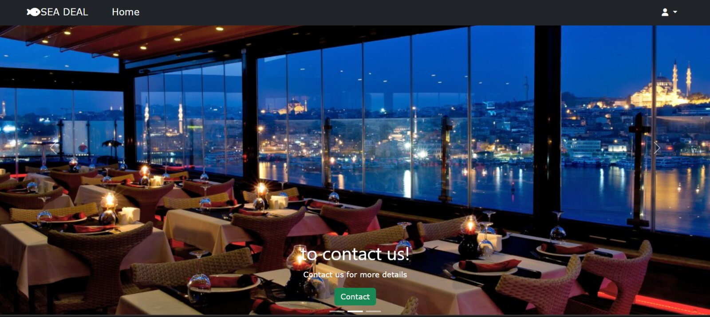
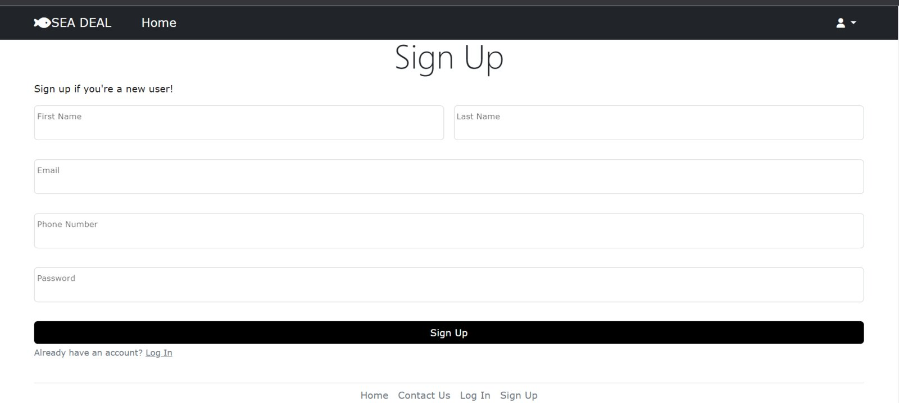
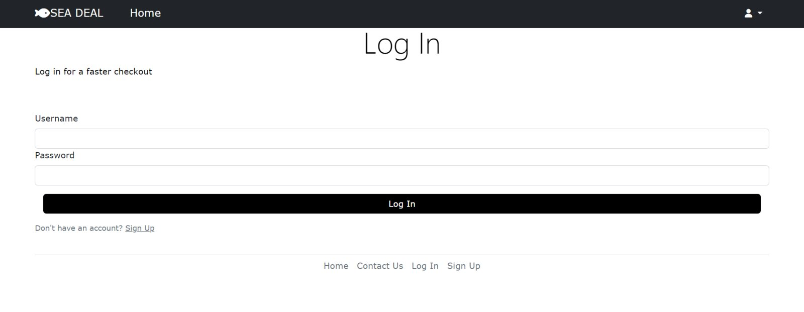
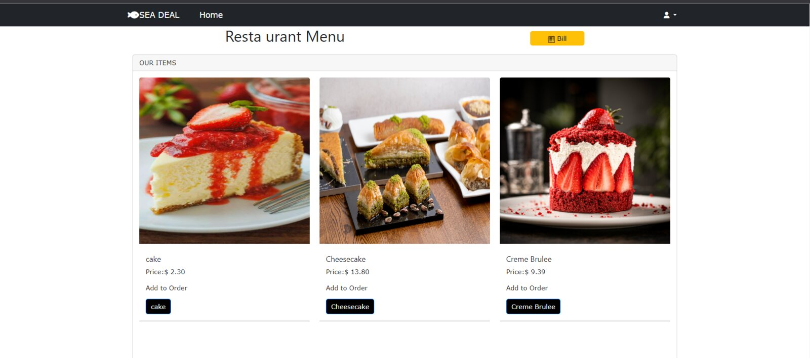
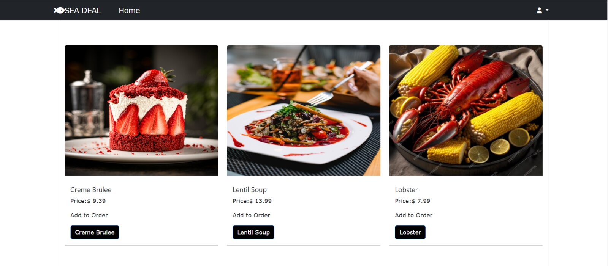
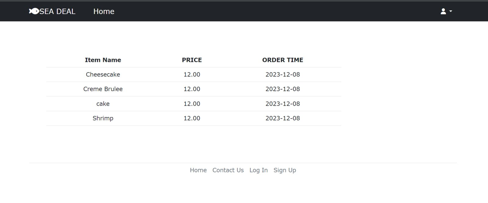
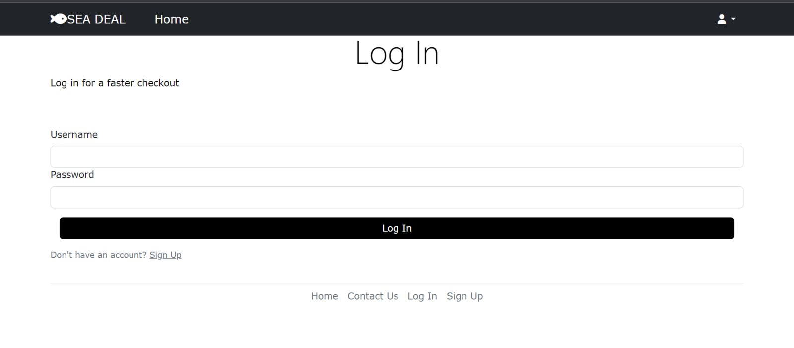
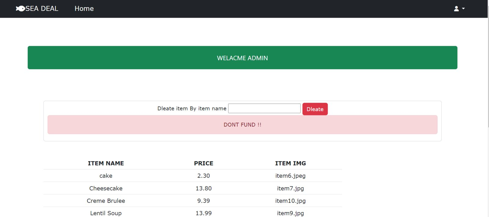
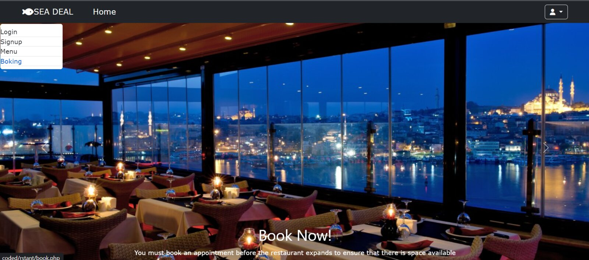

# 🐟 SEA DEAL — Seafood Restaurant Website

A full-stack restaurant website built with **PHP**, **MySQL** and **Bootstrap**. Customers can sign up, log in, browse the menu, place orders, view their bill and book a table. An admin page lets the restaurant manage menu items.

> Web development course final project (December 2023) — team of 3.



---

## ✨ Features

| Feature | Description |
|---|---|
| **Home page** | Bootstrap carousel with quick links to the menu, contact and booking pages |
| **Sign up / Log in** | Customer accounts stored in MySQL (passwords hashed with SHA-1), session-based login |
| **Interactive menu** | Dishes loaded dynamically from the database with images and prices; one click adds an item to the order |
| **Online ordering** | Each order is saved to the `orders` table and linked to the logged-in customer |
| **Bill** | Shows every item the customer ordered with price and order date |
| **Table booking** | Shows the customer's details and lets them choose a time, party size and email confirmation |
| **Admin panel** | Lists all menu items and deletes an item by name |
| **Contact / About** | Restaurant info, working hours and contact cards |
| **Responsive design** | Built with Bootstrap 5 so it works on phones and desktops |

### CRUD coverage

- **Create** — new customers (`signup.php`) and new orders (`Menu.php`)
- **Read** — menu items (`Menu.php`, `admin.php`), customer info (`book.php`), orders (`bill.php`)
- **Delete** — remove a menu item (`admin.php`)

---

## 🛠️ Tech Stack

- **Front end:** HTML5, CSS3, Bootstrap 5, Font Awesome, JavaScript (form validation)
- **Back end:** PHP 8 (PDO)
- **Database:** MySQL / MariaDB
- **Local server:** XAMPP (Apache + MariaDB + phpMyAdmin)

---

## 📁 Project Structure

```
seafood-restaurant-website/
├── src/                      # Website source (copy this into your web server)
│   ├── index.php             # Entry point → redirects to seafood.php
│   ├── seafood.php           # Home page
│   ├── signup.php            # Customer registration
│   ├── login.php             # Customer / admin login
│   ├── Menu.php              # Menu + place orders
│   ├── bill.php              # Customer bill
│   ├── book.php              # Table booking
│   ├── Contact.php           # About & contact
│   ├── admin.php             # Admin panel (delete menu items)
│   ├── includes/
│   │   ├── db.php            # Database connection (PDO)
│   │   ├── header.php        # Navbar
│   │   ├── footer.php        # Footer
│   │   └── links.php         # CSS / JS links
│   └── assets/
│       ├── css/main.css
│       └── images/           # Dish and banner images
├── database/
│   └── restaurant.sql        # Database schema + sample data
└── docs/
    ├── Project-Report.pdf    # Project report
    ├── Project-Report.docx
    └── screenshots/
```

---

## 🗄️ Database

Database name: **`restaurant`** — three tables:

| Table | Columns | Notes |
|---|---|---|
| `customers` | `CustomerID` (PK), `FirstName`, `LastName`, `Email`, `Phone`, `password` | Password stored as SHA-1 hash |
| `foods` | `food_name` (unique), `food_price`, `food_img` | Menu items |
| `orders` | `OrderID` (PK), `CustomerID` (FK), `OrderDate`, `TotalAmount`, `item_name` | `CustomerID` → `customers.CustomerID` |

One customer can have many orders (one-to-many relationship).

---

## 🚀 Run It Locally

1. Install [XAMPP](https://www.apachefriends.org/) and start **Apache** and **MySQL**.
2. Clone this repository:
   ```bash
   git clone https://github.com/Hams770/seafood-restaurant-website.git
   ```
3. Copy the `src` folder into `C:\xampp\htdocs\` and rename it, e.g. `seadeal`.
4. Open **phpMyAdmin** (`http://localhost/phpmyadmin`), create a database named `restaurant`, then **Import** `database/restaurant.sql`.
5. If your MySQL user/password are not the XAMPP defaults (`root` / empty), update them in `src/includes/db.php`.
6. Visit **http://localhost/seadeal/**

**Admin login:** username `admin`, password `admin`.

---

## 📸 Screenshots

| Sign up | Log in |
|---|---|
|  |  |

| Menu | Full menu |
|---|---|
|  |  |

| Bill | Booking |
|---|---|
|  |  |

| Admin panel | Home (hover) |
|---|---|
|  |  |

More screenshots are in [`docs/screenshots`](docs/screenshots).

---

## 🔍 Notes & Possible Improvements

This was a learning project, and these are things I would improve today:

- Use prepared statements with bound parameters everywhere to prevent SQL injection
- Replace SHA-1 with `password_hash()` / `password_verify()`
- Give the admin a proper account and role check instead of a hard-coded login
- Add **Update** (edit menu item price/image) to complete full CRUD
- Store booking requests in the database and send real confirmation emails

---

## 👩‍💻 Team

- **Hams Aljohani**
- Sara Imran
- Sahar Albardawil

📄 Full project report: [docs/Project-Report.pdf](docs/Project-Report.pdf)
